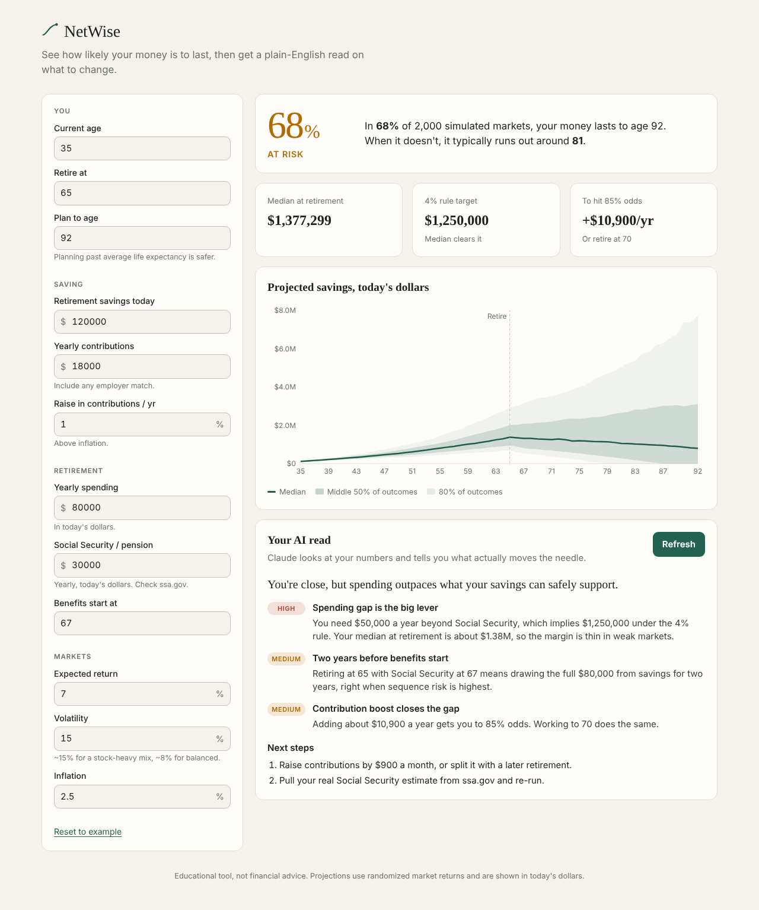

# NetWise

**An AI-powered retirement calculator.** NetWise runs 2,000 Monte Carlo market simulations on your plan, shows how likely your money is to last, and then uses Claude to turn the numbers into a short, specific read on what to change.



## What it does

- **Probability of success.** Simulates 2,000 randomized market paths from today to your plan-to age and reports the share where your savings never run out.
- **Range of outcomes.** A fan chart of portfolio value by age (10th, 25th, 50th, 75th, 90th percentiles), all in today's dollars.
- **The levers.** Solves for the extra yearly contribution, or the retirement age, that gets you to 85% odds.
- **AI insights.** Sends your inputs and the simulation results to Claude, which returns a ranked set of insights and next steps tied to your actual numbers.

## How it works

```
Browser                                   Server (Next.js route)
───────                                   ──────────────────────
Inputs ──► lib/simulate.ts (live, ~150ms)
             │  Monte Carlo + solvers
             ▼
         Chart, stats
                                          POST /api/insights
"Get insights" ──── plan inputs ────────►  validate inputs
                                           re-run simulation server-side
                                           build prompt (lib/insights.ts)
                                           Claude Messages API, forced tool call
         Insights panel ◄── JSON ─────────  { headline, insights[], nextSteps[] }
```

**Simulation (`lib/simulate.ts`).** Runs in real (inflation-adjusted) terms so everything is in today's dollars. Each year draws a normally distributed return around the real expected return. Working years grow the balance then add contributions; retired years withdraw spending net of Social Security, then grow. The RNG is seeded from the inputs, so the same plan always gives the same answer. Solvers use binary search (contributions) and a linear scan (retirement age).

**AI layer (`lib/insights.ts`).** The server re-runs the simulation instead of trusting client-sent results, so the prompt always matches the inputs. Claude is called with a forced tool (`report_insights`) and a JSON schema, which guarantees structured output the UI can render. The system prompt tells the model to use only the provided figures, rank by impact, and flag aggressive assumptions. The API key never leaves the server.

## Tech stack

Next.js 15 (App Router) · React 19 · TypeScript · Recharts · Anthropic TypeScript SDK · Vitest

## Run it locally

```bash
git clone https://github.com/<your-username>/netwise.git
cd netwise
npm install
cp .env.example .env.local   # then add your Anthropic API key
npm run dev
```

Open http://localhost:3000. The calculator works without an API key; only the AI insights panel needs one. Get a key at [console.anthropic.com](https://console.anthropic.com).

| Variable | Required | Default |
| --- | --- | --- |
| `ANTHROPIC_API_KEY` | For insights | none |
| `ANTHROPIC_MODEL` | No | `claude-sonnet-5-5` |

## Scripts

```bash
npm run dev     # local dev server
npm run build   # production build
npm test        # unit tests (simulation engine + prompt/parsing)
npm run lint    # type check
```

## Deploy

Works out of the box on Vercel: import the repo, add `ANTHROPIC_API_KEY` as an environment variable, deploy. If the app is public, put rate limiting in front of `/api/insights` (e.g. Vercel firewall rules or Upstash) so strangers can't burn your API credits.

## Limits of the model

- Returns are normal and independent year to year. Real markets have fat tails and streaks.
- No taxes, account types (401k vs Roth vs taxable), or required minimum distributions.
- Spending is flat in real terms; real retirees usually spend less as they age.
- Social Security is a flat real amount from the start age you choose.

This is an educational tool, not financial advice.

## License

MIT
